<!--
FFM Sentinel — Project README
GitHub README supports Markdown, Mermaid, and limited HTML.
Animations are provided by an external SVG service; GitHub does not run custom CSS or JavaScript here.
-->

<div align="center">


<p>  </p>

<p>
  
  
  
</p>


<p><strong>OFFLINE MULTIMODAL AI COMPANION FOR INTERACTIVE ASSISTANCE</strong></p>

<p>
  A final-year engineering project exploring local AI, multimodal interaction, and embedded computing.
</p>

<p>
  
  
  
  
</p>

<p>
  <a href="#-overview">Overview</a> •
  <a href="#-features">Features</a> •
  <a href="#-architecture">Architecture</a> •
  <a href="#-setup">Setup</a> •
  <a href="#-team">Team</a>
</p>

</div>

---

## ✦ The FFM Sentinel Experience

<div align="center">

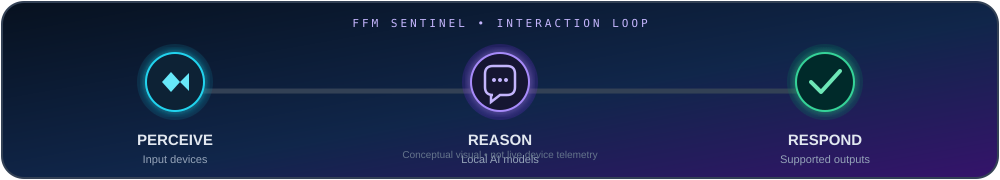


<table>
<tr>
<td align="center" width="33%">
<br/>
<sub>Receive supported inputs</sub>
</td>
<td align="center" width="33%">
<br/>
<sub>Process with configured AI</sub>
</td>
<td align="center" width="33%">
<br/>
<sub>Return supported outputs</sub>
</td>
</tr>
</table>


</div>

---

## ◈ Overview

**FFM Sentinel (Friendly Functional Machine)** is a final-year engineering project focused on building an interactive AI companion by combining AI software, multimodal inputs, and embedded computing.

The project explores the use of locally hosted AI models and hardware-assisted interaction. Its goal is to make AI interaction more self-contained where supported by the configured models, software, and hardware.


## ◈ The Problem

Many AI-powered experiences depend on remote services, internet connectivity, or external infrastructure. These dependencies can introduce connectivity constraints, recurring service costs, and privacy considerations.

FFM Sentinel investigates a compact alternative that brings AI inference and supported input/output devices together in a single interactive system.

## ◈ Project Objectives

- Integrate locally hosted AI models into an interactive application.
- Explore multimodal interaction through supported input devices.
- Connect application software with embedded hardware.
- Investigate local inference and offline operation.
- Document system design, setup, limitations, and test results.
- Evaluate the implementation using repeatable functional tests.

## ◈ Features

The list below describes the intended areas of the project. Mark a capability as complete only after testing it in the current implementation.

| Area | Purpose |
|---|---|
| 🧠 Local AI inference | Run configured AI models through a local runtime |
| 👁️ Visual input | Process camera input when the vision module is enabled |
| 🎙️ Audio interaction | Support microphone or speech features when implemented |
| 💬 Response interface | Present generated responses through available output modules |
| 🔩 Hardware integration | Connect the application to the target computing platform and peripherals |
| 🔒 Local-first direction | Reduce cloud dependence where the full workflow supports local operation |

## ◈ Animated System Architecture

The diagram below uses animated SVG paths and moving signal pulses to make the conceptual data flow easier to follow. It is an illustration, not proof that every module is implemented.

<div align="center">
  
</div>

> **Faculty note:** This is a conceptual architecture. Update its blocks and connections to match the modules actually implemented and tested in the repository.

### Architecture layers

1. **Input layer** — receives supported user input from connected devices.
2. **Processing layer** — prepares input for the appropriate module.
3. **AI layer** — invokes the configured language or vision model.
4. **Response layer** — formats the result for the supported output interface.
5. **Hardware layer** — supplies the compute platform and peripheral connections.

## ✧ Visual Signal Path

<div align="center">


</div>

> The animated labels are visual decoration. They do not indicate live hardware status, model readiness, or real-time system telemetry.

---

## ◈ Technology Stack

| Component | Planned / possible technology |
|---|---|
| Embedded computer | Raspberry Pi 5 |
| Local model runtime | Ollama |
| Language model | Gemma 3, if configured |
| Vision model | Moondream 2, if configured |
| Application language | Python, where used |
| Version control | Git and GitHub |

These are not claims that every component is currently integrated. The final stack should match the working implementation and installed versions.

## ◈ Hardware

The prototype configuration may include:

- Raspberry Pi 5
- Raspberry Pi Camera Module
- USB microphone
- External speaker
- Touchscreen display
- Compatible power supply and storage
- Additional controllers, switches, and accessories as required

Record the exact components used in the final build in the project documentation.

## ◈ Setup

### Prerequisites

- Git
- Python version required by the project
- Project dependencies
- Ollama and required model files, if used
- Compatible hardware for hardware-dependent features

### 1. Clone the repository

```bash
git clone https://github.com/ayushpimple30/BE---Comps---B---FFM.git
cd BE---Comps---B---FFM
```

### 2. Create and activate a virtual environment

```bash
python -m venv .venv
```

**Windows (Command Prompt):**

```bat
.venv\Scripts\activate
```

**Linux / Raspberry Pi OS:**

```bash
source .venv/bin/activate
```

### 3. Install dependencies

If the repository contains a `requirements.txt` file:

```bash
python -m pip install -r requirements.txt
```

### 4. Configure models

If Ollama is part of the implementation, install it and download the exact models required by the application. For example, only if these model names match your configuration:

```bash
ollama pull gemma3
ollama pull moondream
```

### 5. Run the application

Use the actual entry-point file and run instructions from the source code:

```bash
python YOUR_ENTRY_POINT.py
```

Replace `YOUR_ENTRY_POINT.py` with the real script name. Additional hardware configuration may be required.

## ◈ Repository Guide

Keep the README media organised like this. Create only the folders you need; do not move existing source files just to match this example.

```text
BE---Comps---B---FFM/
├── README.md
├── assets/
│   ├── diagrams/
│   │   └── animated-architecture.svg
│   ├── images/
│   │   ├── bmo-prototype.jpg
│   │   ├── prototype-front.jpg
│   │   └── hardware-internals.jpg
│   └── screenshots/
│       ├── application.png
│       ├── ai-response.png
│       └── multimodal-test.png
├── docs/
└── [existing source files and folders]
```

**Where to add images:** open the repository → **Add file** → **Upload files** → drag the images into the matching folder. If a folder does not exist, include its name in the upload path or create a placeholder file first. Keep filenames simple and use the same spelling and extension as the README paths.

## ◈ Prototype Gallery

<div align="center">

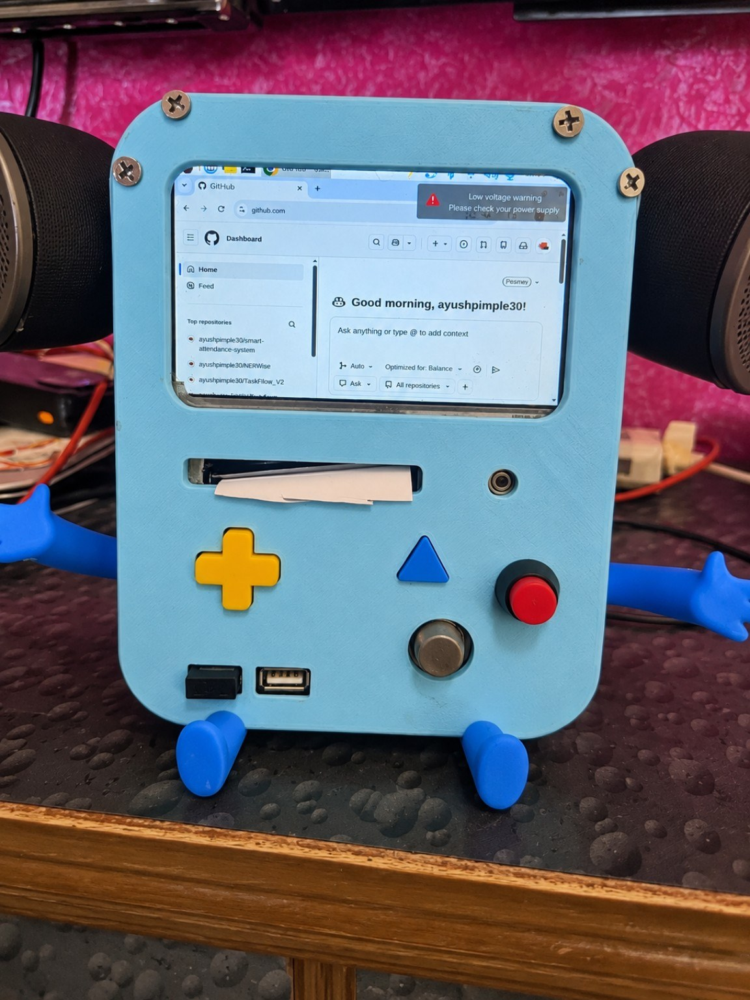

<p><strong>FFM SENTINEL · PHYSICAL PROTOTYPE</strong></p>
<sub>A custom BMO-inspired enclosure with display, physical controls, speaker housings, and embedded-computing hardware.</sub>

</div>

<div align="center">


</div>

### The build, from the outside in

<table>
<tr>
<td width="50%" align="center" valign="top">

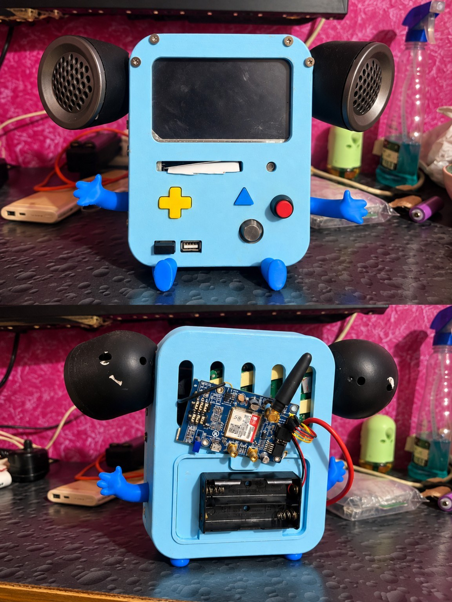

**01 · Assembled prototype**

<sub>Front view of the enclosure, display, buttons, arms, and feet.</sub>

</td>
<td width="50%" align="center" valign="top">


**02 · Internal assembly**

<sub>A look inside the enclosure at the mounted electronics and battery holder.</sub>

</td>
</tr>
<tr>
<td width="50%" align="center" valign="top">

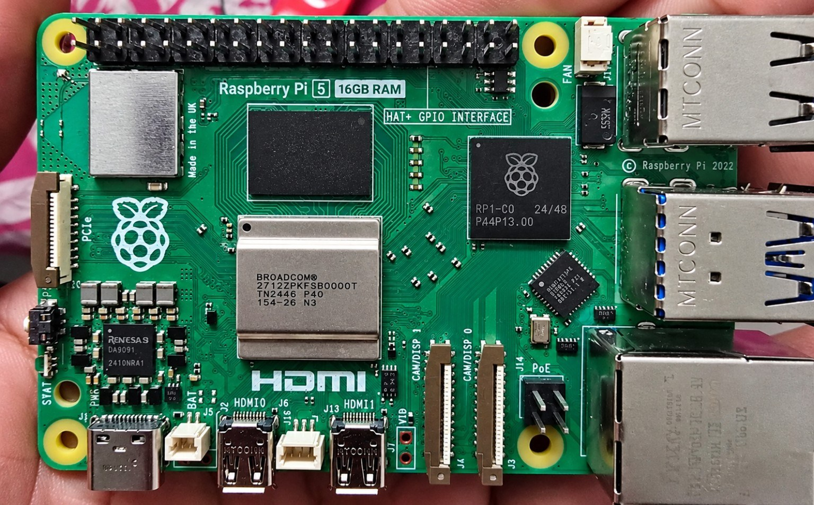

**03 · Compute platform**

<sub>Raspberry Pi 5 with 16GB RAM, the intended embedded-computing platform.</sub>

</td>
<td width="50%" align="center" valign="top">

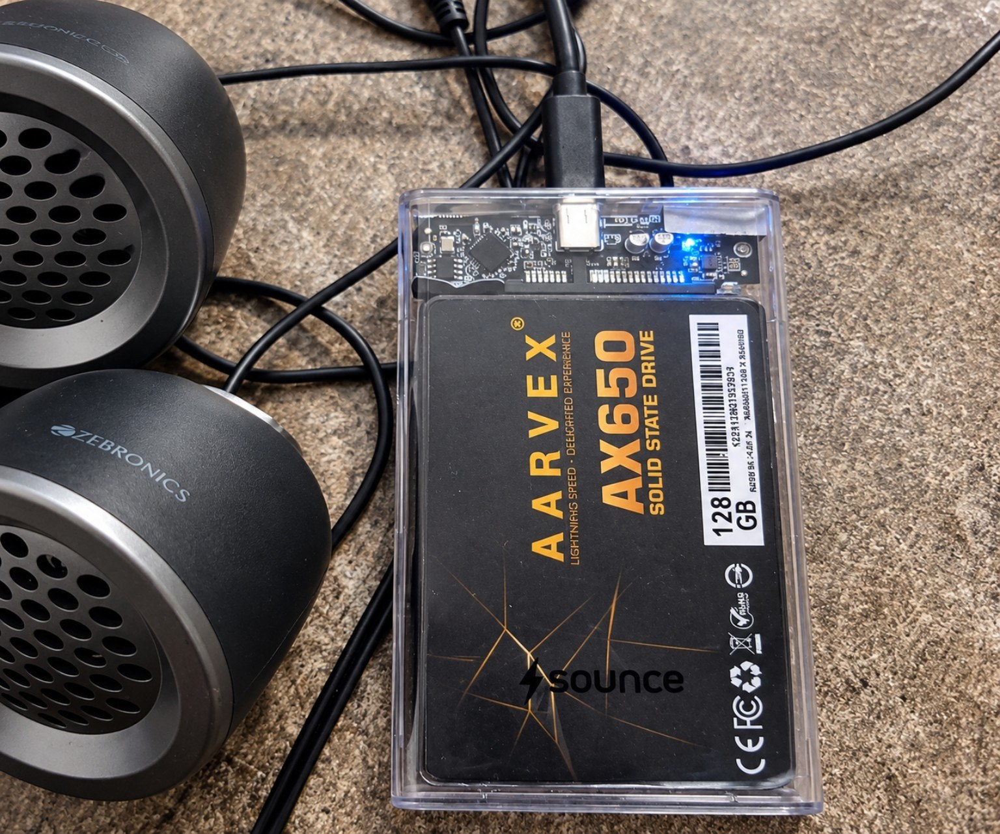

**04 · Storage hardware**

<sub>128GB solid-state drive in an external enclosure.</sub>

</td>
</tr>
</table>

<div align="center">


</div>

### Interface states

<table>
<tr>
<td width="33%" align="center" valign="top">

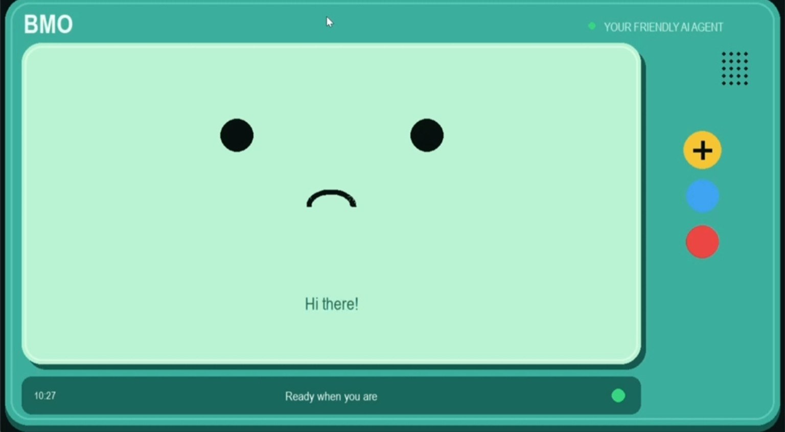

**Welcome state**

<sub>Interface example displaying a greeting and ready status.</sub>

</td>
<td width="33%" align="center" valign="top">

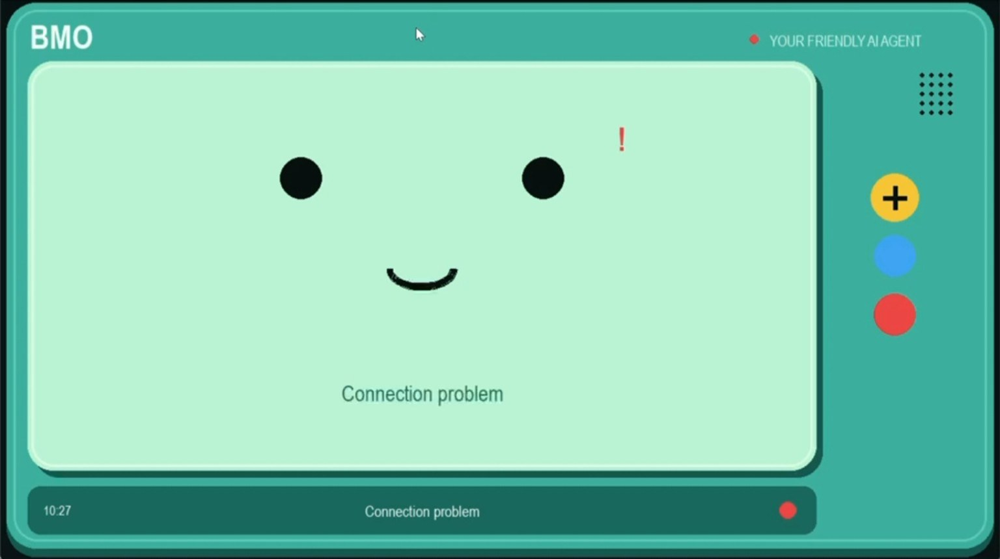

**Connection status**

<sub>Example of the interface communicating a connection issue.</sub>

</td>
<td width="33%" align="center" valign="top">

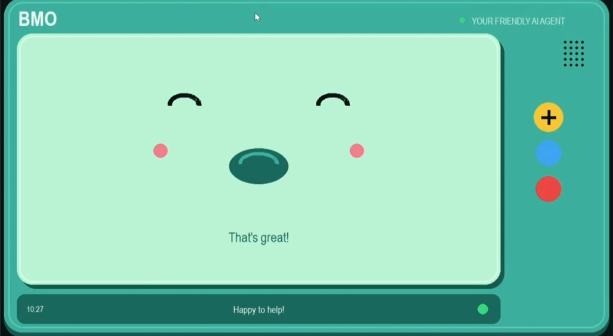

**Response state**

<sub>A friendly response screen with a positive status indicator.</sub>

</td>
</tr>
</table>

### Implementation references

The following images are **documentation/code reference screenshots**. They illustrate implementation ideas and are not, by themselves, proof that every shown module is present or running in the current repository.

<details>
<summary><strong>Audio orchestration · speech-to-text and text-to-speech reference</strong></summary>

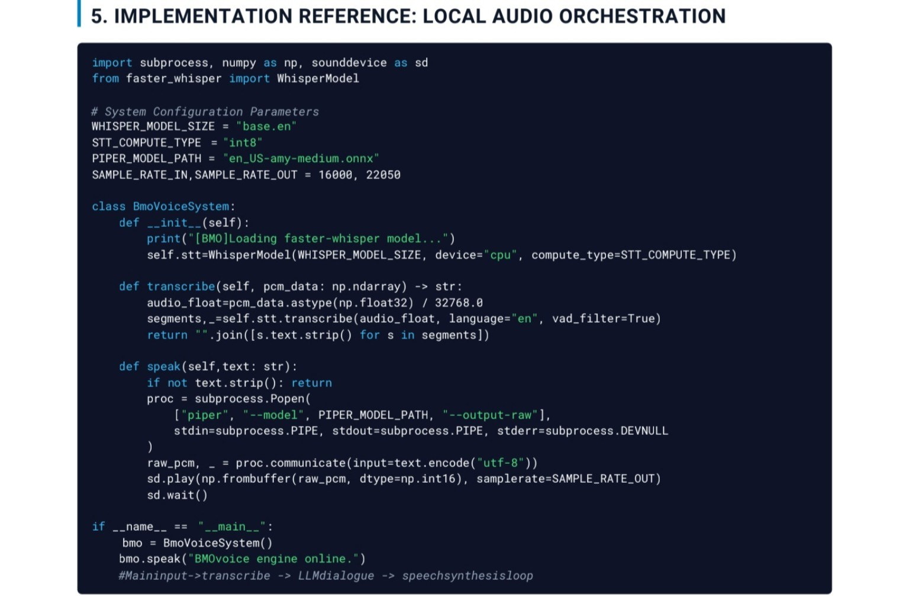

</details>

<details>
<summary><strong>Edge synchronization and queue endpoint reference</strong></summary>

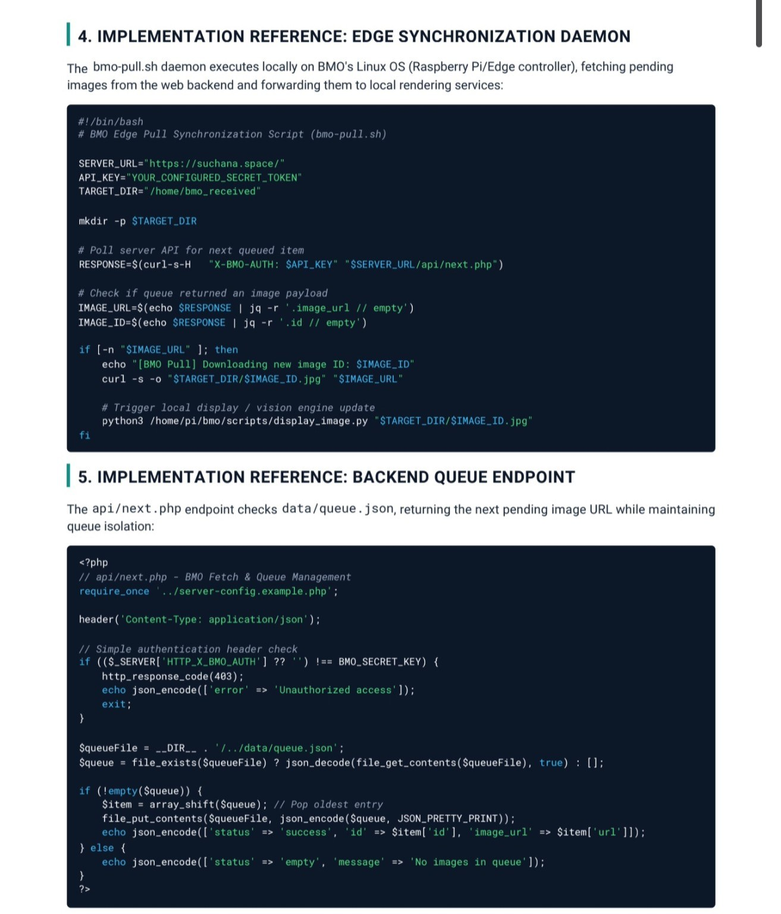

</details>

<details>
<summary><strong>Upload validation and security reference</strong></summary>

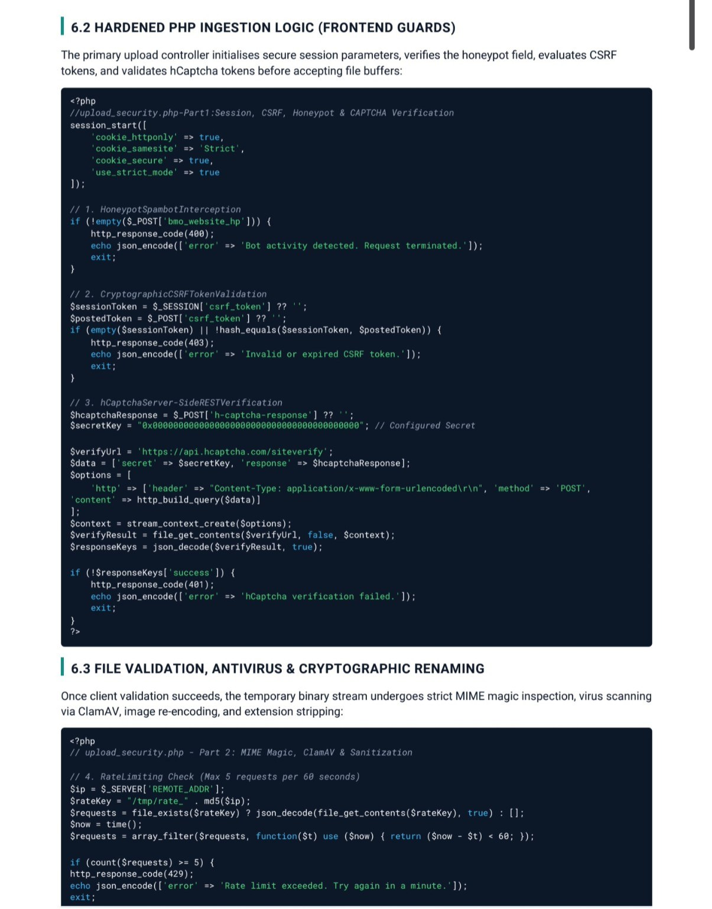

</details>

<details>
<summary><strong>Game execution and display management reference</strong></summary>

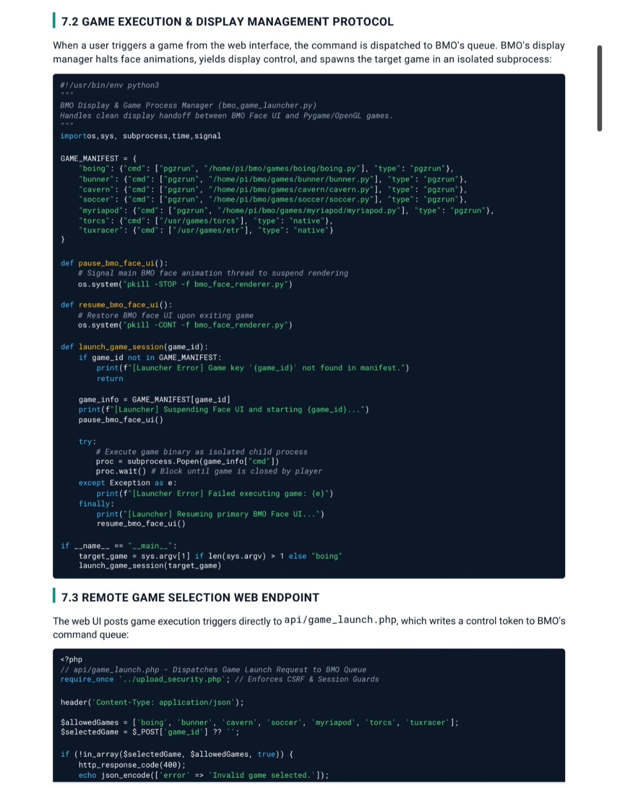

</details>

<details>
<summary><strong>Queue schema and JSON payload reference</strong></summary>

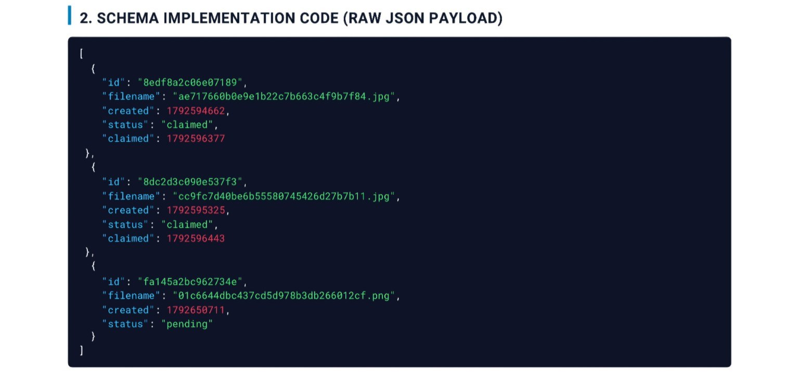

</details>

<details>
<summary><strong>Hash verification pipeline reference</strong></summary>

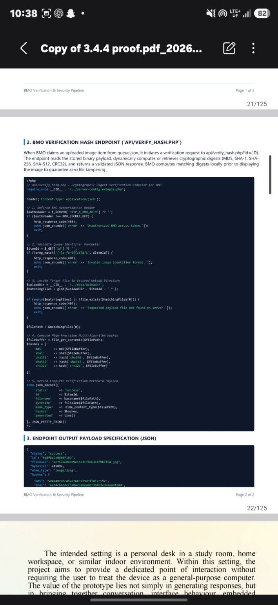

</details>


## ◈ Implementation Evidence

Use this section to demonstrate the work completed—not just the planned design.

For each implemented feature, add:
- A genuine screenshot or prototype photograph
- The test input and expected behaviour
- The observed output
- Pass/fail status
- Relevant limitations or known issues

Suggested evidence to include:

| Evidence | What it demonstrates |
|---|---|
| Application running | Successful startup |
| Model response | AI integration |
| Camera test | Visual pipeline, if implemented |
| Audio test | Audio pipeline, if implemented |
| Prototype photograph | Hardware assembly |
| Test summary | Repeatable validation results |

Do not publish fabricated screenshots, performance numbers, or test outcomes.

## ◈ Development Roadmap

- [ ] Verify the end-to-end application workflow
- [ ] Validate configured AI models
- [ ] Test implemented input and output modules
- [ ] Verify operation on the target hardware
- [ ] Add actual screenshots and prototype photographs
- [ ] Document functional tests and known limitations
- [ ] Finalise installation instructions and project report

Update this checklist as work is completed.

## ◈ Limitations

Performance depends on available memory, compute capability, model size, dependencies, and the quality of the implementation. Local model inference does not by itself guarantee that every feature works offline; the full application workflow and its dependencies must be tested.

## ◈ Future Scope

- Improve response latency and resource utilisation.
- Expand supported multimodal interaction.
- Strengthen hardware integration and recovery from errors.
- Improve interface usability and accessibility.
- Measure reliability and offline behaviour under repeatable test conditions.

## ◈ Project Team

**Institution:** St. John College of Engineering and Management  
**Programme:** B.Tech  
**Department:** Computer Engineering  
**Project Guide:** Dr. Mahesh Maurya

| Team member | Roll number |
|---|---:|
| Ayush Pimple | 24 |
| Harshal Raut | 34 |
| Shreyash Patil | 18 |
| Sarvesh Patil | 17 |

## ◈ License and Copyright

This repository's original project code and documentation are licensed under the **MIT License**. See [LICENSE](LICENSE) for the full terms and [COPYRIGHT.md](COPYRIGHT.md) for the project copyright notice.

Copyright (c) 2026 FFM Sentinel Project Team.

The MIT License permits use, modification, and redistribution subject to its conditions, including preservation of the copyright and license notices. Third-party libraries, AI models, assets, and hardware designs may have separate terms; check those terms before use or redistribution. [MIT License details](https://opensource.org/license/MIT).

See [CONTRIBUTING.md](CONTRIBUTING.md) for contribution guidance and [SECURITY.md](SECURITY.md) for vulnerability reporting.

## 📈 Project Activity

<div align="center">


<sub>Activity is generated from actual repository history and may take time to refresh. This graphic is separate from GitHub's small green sparkline on your profile.</sub>

</div>

---

## ◈ Developer and Project Resources

| Resource | Purpose |
|---|---|
| [Setup and Troubleshooting](docs/SETUP_AND_TROUBLESHOOTING.md) | Environment preparation and common setup issues |
| [Testing and Validation](TESTING.md) | Repeatable test cases and recording real results |
| [Implementation Evidence](docs/TEST_EVIDENCE.md) | Checklist for genuine screenshots and prototype evidence |
| [Contributing](CONTRIBUTING.md) | Contribution workflow and code expectations |
| [Security Policy](SECURITY.md) | How to report potential vulnerabilities |
| [Code of Conduct](CODE_OF_CONDUCT.md) | Expectations for respectful collaboration |
| [Changelog](CHANGELOG.md) | Summary of notable project updates |
| [Citation metadata](CITATION.cff) | Information for citing the project |
| [License](LICENSE) and [Copyright](COPYRIGHT.md) | Reuse terms and project copyright notice |

Automated Python syntax validation is configured in GitHub Actions. It checks Python files for syntax/compilation errors; it does not prove that hardware, models, or end-to-end features work.

## ◈ References

- [Python Documentation](https://docs.python.org/3/)
- [Raspberry Pi Documentation](https://www.raspberrypi.com/documentation/)
- [Ollama Documentation](https://docs.ollama.com/)
- [GitHub Markdown Documentation](https://docs.github.com/en/get-started/writing-on-github)

---

<div align="center">


<sub>Final-year engineering project • St. John College of Engineering and Management</sub>

</div>
