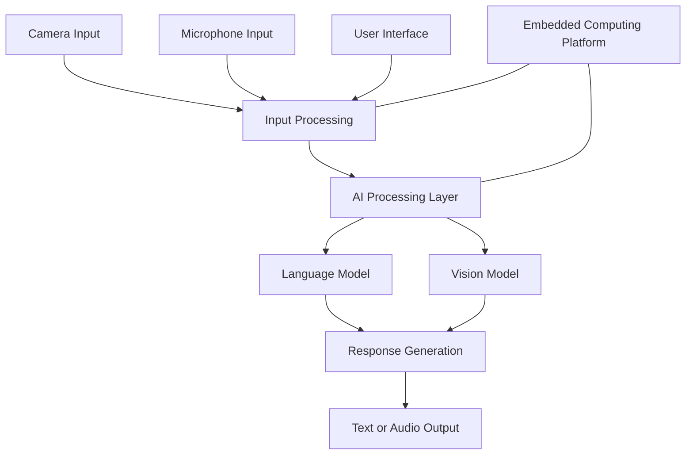

# FFM Sentinel

### Offline Multimodal AI Companion for Interactive Assistance

<div align="center">
  
</div>

<p align="center">
  <b>A Final-Year Engineering Project</b><br>
  Exploring local AI, multimodal interaction, and embedded computing.
</p>

<p align="center">
  
  
  
  
</p>

---

## Overview

**FFM Sentinel** is a final-year engineering project exploring the integration of artificial intelligence, multimodal interaction, and embedded computing into an interactive AI companion.

The project investigates local AI inference and hardware-assisted interaction, with the goal of reducing reliance on cloud processing where feasible.

## Problem Statement

Many AI-powered systems depend on external services and continuous internet connectivity. FFM Sentinel explores how locally hosted AI models and compatible hardware can support a more self-contained interactive system.

## Objectives

- Integrate locally hosted AI models.
- Explore multimodal user interaction.
- Develop an interactive application interface.
- Investigate offline AI processing.
- Integrate software with embedded hardware.
- Evaluate the implementation through practical testing.

## Key Features

- **Local AI:** Integration with locally hosted models, where configured.
- **Visual Processing:** Camera-based interaction, if implemented.
- **Voice Interaction:** Audio input and speech output, if implemented.
- **Hardware Integration:** Support for compatible embedded devices.
- **Interactive Interface:** User-facing responses through implemented output modules.

Only features verified in the current implementation should be presented as completed.

## System Architecture



*This is a conceptual architecture. Update it to match the actual implemented modules.*

## Technology Stack

| Component | Technology |
|---|---|
| Computing platform | Raspberry Pi 5, if deployed |
| AI runtime | Ollama, if configured |
| Language model | Gemma 3, if integrated |
| Vision model | Moondream 2, if integrated |
| Programming language | Python, where used |
| Version control | Git and GitHub |

## Hardware Requirements

The intended setup may include a Raspberry Pi 5, camera module, microphone, speaker, touchscreen, compatible power supply, and other required peripherals.

The final list should reflect the actual prototype.

## Installation and Setup

### 1. Clone the repository

```bash
git clone https://github.com/ayushpimple30/BE---Comps---B---FFM.git
cd BE---Comps---B---FFM
```

### 2. Create a virtual environment

```bash
python -m venv .venv
```

On Windows:

```bat
.venv\Scripts\activate
```

On Raspberry Pi OS or Linux:

```bash
source .venv/bin/activate
```

### 3. Install dependencies

If a `requirements.txt` file is provided:

```bash
python -m pip install -r requirements.txt
```

### 4. Configure the AI models

If your implementation uses Ollama, install the runtime and download the required models according to your project configuration.

### 5. Run the application

Use the actual Python entry-point filename documented in the repository.

```bash
python YOUR_ENTRY_POINT.py
```

Replace the placeholder with the correct filename.

## Project Structure

The following is an example structure; update it to match the actual repository.

```text
FFM-Sentinel/
├── README.md
├── requirements.txt
├── .gitignore
├── src/
├── docs/
├── assets/
│   ├── diagrams/
│   └── screenshots/
└── tests/
```

## Implementation and Results

Add genuine screenshots, prototype photographs, test cases, and execution results here.

For each test, document the input, expected output, observed output, and whether the test passed.

## Future Scope

- Improve inference performance and response latency.
- Expand multimodal interaction.
- Improve hardware integration and error handling.
- Enhance the user interface.
- Evaluate reliability under offline conditions.

## Limitations

Performance depends on hardware resources, model size, software dependencies, and the features implemented. Local inference does not automatically guarantee that every application feature works without an internet connection.

## Project Team

**Institution:** St. John College of Engineering and Management  
**Programme:** B.Tech  
**Department:** Computer Engineering  
**Project Guide:** Dr. Mahesh Maurya

| Team Member | Roll Number |
|---|---:|
| Ayush Pimple | 24 |
| Harshal Raut | 34 |
| Shreyash Patil | 18 |
| Sarvesh Patil | 17 |

## References

- [Python Documentation](https://docs.python.org/3/)
- [Raspberry Pi Documentation](https://www.raspberrypi.com/documentation/)
- [Ollama Documentation](https://docs.ollama.com/)
- [GitHub Markdown Guide](https://docs.github.com/en/get-started/writing-on-github)

---

<p align="center">
  <b>FFM Sentinel</b><br>
  Engineering intelligence into interaction.
</p>
